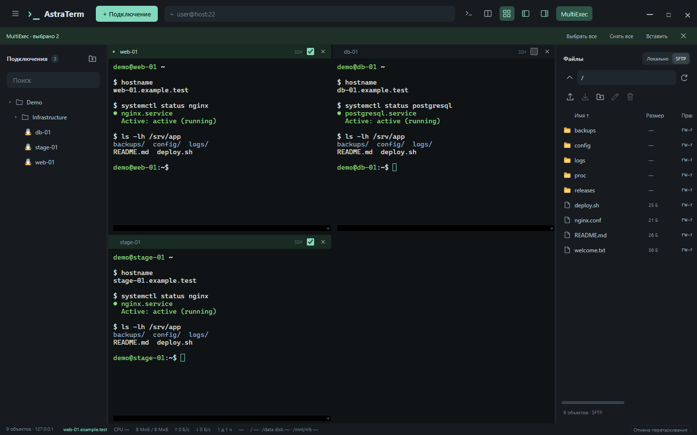

# AstraTerm

AstraTerm объединяет терминалы, SSH, SFTP и удалённый рабочий стол в одном приложении для **Windows x64** и **Astra Linux Special Edition 1.6 x86-64**.

[Официальный сайт](https://astraterminal.ru/) · [Скачать последнюю версию](https://github.com/Shogenov/AstraTerm/releases/latest) · [История релизов](https://github.com/Shogenov/AstraTerm/releases)



## Установка и обновление

| Платформа | Пакет |
| --- | --- |
| Windows x64 | `AstraTerm-<версия>-Windows-x64-Setup.exe` устанавливает приложение для текущего пользователя. Доступны также portable EXE и ZIP. Для готовых сборок Node.js и Python не нужны. |
| Astra Linux SE 1.6 | Откройте `astraterm_<версия>_all.deb` системным установщиком пакетов. Для запуска нужен графический сеанс. |

После установки откройте AstraTerm из меню приложений. Для ручной проверки обновлений выберите **Справка → Проверить обновления…**. Приложение проверяет подпись списка релизов, размер и SHA-256 пакета перед установкой. [Как работают обновления](docs/UPDATES.md)

## Возможности

- **Подключения.** Сохранённые SSH и RDP, вложенные папки с общими SSH-настройками, цепочки SSH-шлюзов и туннели.
- **Рабочее пространство.** Локальные и удалённые терминалы во вкладках, разделение экрана между существующими подключениями, отдельные окна и переподключение.
- **MultiExec.** Ввод и вставка в выбранные терминалы. Чтобы начать, откройте общий вид, отметьте нужные панели и включите MultiExec.
- **SFTP.** Файловая панель активного SSH-подключения, просмотр свойств, сортировка, редактирование текста и перетаскивание файлов в обе стороны. С 0.10.21 файл, сброшенный на SSH-терминал, загружается в рабочий каталог оболочки. Для этого оболочка должна передать путь через OSC 7 или заголовок Bash. При сбросе на панель SFTP используется каталог, открытый в панели.
- **RDP.** Удалённый рабочий стол открывается во вкладке через Microsoft ActiveX на Windows или FreeRDP X11 на Astra Linux. [Настройка RDP и ограничения](docs/RDP.md)
- **Состояние хоста.** Загрузка CPU, память, сеть, диски и активные пользователи для локальной машины и поддерживаемых SSH-хостов. [Поддерживаемые метрики](docs/HOST_STATUS.md)
- **Перенос настроек.** Импорт подключений из AstraTerm, Termius CSV, OpenSSH config и Ásbrú YAML. Зашифрованная резервная копия переносит профиль, учётные данные и выбранные SSH-ключи. Обычный экспорт сессий не содержит паролей. [Форматы импорта](docs/IMPORTS.md) · [Резервное копирование](docs/BACKUP.md)

В Linux доступны X11 forwarding и подключения через системные клиенты Mosh, Telnet, Serial и VNC. На Windows доступны локальный PowerShell, SSH, SFTP и RDP. [Сравнение платформ](docs/PLATFORM_PARITY.md) · [Матрица функций](docs/FEATURES.md)

## Запуск из исходников

**Windows.** Понадобятся Node.js 22.12 или новее, npm и .NET Framework 4.x для сборки встроенного RDP-компонента.

```powershell
cd windows
npm ci --omit=optional
npm start
```

**Astra Linux.** Установите зависимости из настроенных репозиториев APT. Скрипт запуска использует системный Python с GTK/VTE. [Подготовка среды](docs/BUILD.md)

```sh
sh scripts/install.sh --deps
~/.local/bin/astraterm
```

При уже установленных зависимостях можно запустить текущие исходники командой `sh scripts/astraterm`.

## Сборка и выпуск

Astra Linux использует Python 3.5, GTK 3.22, VTE 0.46 и системный OpenSSH. Windows использует Electron, xterm.js, ConPTY и SSH2. Общая версия и параметры находятся в `shared/product.json`. Проверка синхронизации выполняется командой `python tools/sync_shared.py --check`.

Для локальной сборки из корня проекта используйте PowerShell. `astra-build` — имя подготовленного Linux-хоста в конфигурации SSH.

```powershell
.\build-windows.ps1
.\build-linux.ps1 -LinuxHost astra-build
.\build-all.ps1 -LinuxHost astra-build
```

Артефакты, контрольные суммы и отчёты сохраняются в `dist/releases/<версия>/`. На Astra Linux можно собрать пакет напрямую командой `/usr/bin/python3.5 tools/build.py linux`. [Параметры сборки и проверки](docs/BUILD.md)

В GitHub Actions ручной запуск **AstraTerm Release → Run workflow** собирает и проверяет оба пакета. Отправка тега `vX.Y.Z` для коммита из истории `main` запускает публикацию на сайте и в GitHub Releases. Тег должен совпадать с версией из `shared/product.json`. [GitHub Actions](https://github.com/Shogenov/AstraTerm/actions/workflows/release.yml)

## Документация

- [Архитектура](docs/ARCHITECTURE.md) и [карта правок](docs/DEVELOPMENT.md)
- [Правила разработки](agent.md) и [план развития](docs/ROADMAP.md)
- [Компоненты и их лицензионные уведомления](docs/THIRD_PARTY_NOTICES.md)
