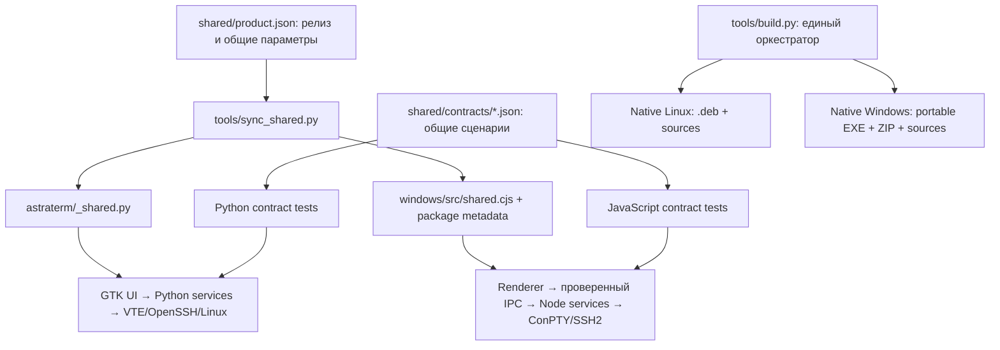

# Архитектура AstraTerm

Публикация сайта/релизов и общий доверенный канал обновлений описаны в [UPDATES.md](UPDATES.md). Версии ОС могут различаться в одном подписанном feed; общая схема и ключ берутся из product.json. UI не задаёт URL/команды установщику, а скачивание и установка отделены от терминалов и сохранённых SSH-секретов.

## Решение: один продукт, два платформенных адаптера

Один релиз и один пользовательский контракт. GTK/VTE сохраняется для Astra 1.6, Electron/ConPTY — для Windows. Современный Electron нельзя считать совместимым с библиотеками Astra 1.6; перенос Linux на Windows-стек не является способом устранить дублирование. Перенос всех функций в Python/GTK на Windows тоже лишит приложение проверенного ConPTY. Поэтому совместно используем данные, контрактные примеры и сборку; реализация системных механизмов остаётся платформенной.

Уже сделано: генерация общих параметров в обе реализации, одинаковые сценарии контрактов, единый номер релиза и три точки входа сборки. Сами валидаторы, контроллеры UI и сетевые библиотеки не объединены в один исполняемый модуль. Не выдавать общие тесты за единый runtime.

## Слои и ответственность

| Слой | Отвечает за | Не должен делать |
| --- | --- | --- |
| Общая спецификация `shared/` | Версия, схема, порты, поля наследования, примеры одинакового поведения | Хранить секреты, пути пользователя, подключения к конкретным ВМ, объявлять протокол работающим по наличию имени |
| Домен `core.py` / `store.cjs`, MultiExec routers | Валидация, миграция, наследование, явный состав получателей | Зависеть от GTK/DOM, запускать shell, спрашивать пароль |
| Сервисы и адаптеры | PTY/SSH, доверие, ключи, файлы, туннели; владение ресурсами и поколениями | Выбирать сервер по текущему UI-фокусу после начала операции, отключать проверку ключей |
| Контроллеры UI | Выбор активной панели, формы, действия, состояние busy/dirty/selection | Содержать альтернативный валидатор или дублировать файловую запись напрямую |
| Представление | GTK/CSS либо DOM/CSS, нативные поля и терминальный виджет | Доступ к секретам/произвольному Node API из renderer, собственный неполный ANSI-парсер |
| Сборка/приёмка | Генерация, native tests, упаковка, hashes и точный результат каждого target | Подменять отсутствие .deb исходным tar.gz; считать старый EXE результатом новой сборки |

В текущем коде часть контроллеров ещё находится в больших `app.py`, `files.py`, `renderer/app.js`, `main.cjs`. Карта функций в `DEVELOPMENT.md` позволяет менять нужный участок без чтения всего файла. При следующей существенной правке области выделять её контроллер за существующим публичным интерфейсом; не делать массовую перестройку несвязанных модулей вместе с маленьким исправлением.

## Сущности и стабильные интерфейсы

- **SessionProfile**: ID, протокол, host/user/port, группа, собственные параметры, `inherit_group_ssh`, ссылки на метаданные ключа. Не является работающим соединением. Хранимый Linux-профиль может быть недоступен для открытия в Windows.
- **GroupProfile**: ID, путь `Parent/Child`, частичные `ssh`-overrides. Общий список восьми полей генерируется. Host и remote command принадлежат сессии. Переименование переносит subtree с сохранением ID; удаление сохраняет сессии и их эффективные параметры.
- **ResolvedSession**: проверенный результат наследования непосредственно перед новым подключением; изменения папки не переписывают уже работающий процесс.
- **TerminalHandle**: ID, profile, generation, status, процесс/PTY/SSH-клиент, принадлежащие ему каналы/подписки. ID UI не заменяет поколение соединения.
- **IdentityProfile**: ID, имя, путь, публичный fingerprint. Материал ключа и passphrase живут в агенте/памяти сервиса, не в SessionStore и не в событиях renderer.
- **CredentialProfile/Vault**: ID, имя, пользователь и пароль серверной учётной записи. Всё содержимое отдельного `credentials.vault.json` зашифровано мастер-паролем; в сессии только `credential_profile`/`credential_label`. Это отдельная сущность от IdentityProfile и passphrase ключа. `vault.py`/`backend/vault.cjs` используют библиотечный AES-GCM, общий envelope и параметры; [IMPORTS.md](IMPORTS.md).
- **ImportPlan**: проверенные сессии/папки, временные секреты и предупреждения. В renderer возвращается только предпросмотр без секретов. После подтверждения — атомарный vault, затем атомарная база сессий; если второй шаг не удался, явно сообщить, что пароли сохранены отдельно и импорт сессий нужно повторить. Это не транзакция двух файлов. Исходник не выполняется и не изменяется; стабильные ID связывают два MobaXterm-файла независимо от порядка импорта.
- **FileBinding**: mode, terminal ID, generation, конкретный transport, path; для редактора ещё revision. Получатель фиксируется до диалога/await. Результат можно показать только всё ещё соответствующему представлению, а саму операцию завершать на исходном endpoint.
- **Macro**: пользовательский текст и признак Enter; отправка программная, только активному терминалу.
- **TunnelProfile/Handle**: сохраняемая конфигурация отдельно от работающего listener. В Windows listener использует существующий SSH-клиент, в Linux запускает OpenSSH. Закрытие исходного ресурса освобождает дочерние каналы.

| Контракт | Linux | Windows |
| --- | --- | --- |
| Проверить профиль | `core.validate_session` | `store.validateSession` |
| Разрешить группу | `SessionStore.resolve_session` | `Store.resolveSession` |
| Изменить/удалить группу | `upsert_group`, `delete_group` | `upsertGroup`, `deleteGroup` |
| Терминальный lifecycle | `TerminalPane`, события VTE/процесса | `TerminalManager.create/write/resize/close/reconnect` |
| Состав MultiExec | `MultiExecController` | `InputRouter` |
| Файловый сервис | `FileBrowser` + transport helpers | `FilesService` через IPC |

Новые вызовы должны использовать существующий сервис. Названия Python snake_case и JS camelCase не обязаны совпадать; семантика и тестовые сценарии обязаны.

Портативная копия профиля шифруется независимо от хранилища паролей и включает его прежний зашифрованный файл. При восстановлении обе платформы материализуют полное дерево в отдельном защищённом каталоге. Атомарно переключаемый `active-profile.json` выбирает его при запуске, поэтому провал записи или работа прежнего экземпляра не смешивают старые компоненты с новыми. [Состав и точки входа](BACKUP.md).

## Потоки событий и владение

**Ввод:** UI проверяет, что событие действительно пользовательское → router получает снимок состава получателей → отправляет ровно один экземпляр подходящим живым терминалам. В Linux VTE уже передал ввод источнику: router отправляет только соседям. В Windows router отвечает также за источник. Кодировки преобразуются у транспортных границ; вставка применяется отдельно к каждому эмулятору ради bracketed paste. Ответы эмулятора, фокус, мышь и макросы не становятся источником рассылки.

**Lifecycle:** `connecting → running → exited/error → reconnect/close`; reconnect увеличивает generation и сбрасывает выбор MultiExec. Все callbacks проверяют владение и поколение. Перемещение UI-панели не создаёт новый TerminalHandle. В Linux специальный незавершённый VTE paste сохраняет старый терминал для чтения и создаёт новый неотмеченный — это платформенная реализация общего запрета отправлять старую вставку новому процессу.

**Вкладки:** вкладка владеет компоновкой существующих панелей, а не новым транспортом. Объединение и разъединение меняют только эту компоновку. Linux `TerminalWorkspace(existing_pane=...)` принимает панель через `_adopt_pane`, перепривязывает callbacks и не запускает процесс; Windows перемещает ID между `state.groups`, сохраняя `state.panes`. DND различает внутренние токены вкладки/панели, отбрасывает внешние и устаревшие источники. GTK завершает drag до reparent через idle callback. Меню захватывает нажатую вкладку; bulk close фиксирует список до единственного подтверждения и повторно проверяет исходную вкладку. Разъединение через меню сохраняет текущий фокус, перетаскиванием — выбирает вытянутую панель.

**Отдельные окна** меняют владельца представления. Linux сохраняет workspace в notebook и переносит дерево виджетов, заново создавая нативные окна для вложенных Gtk.Paned. Windows использует подготовленный same-site popup с исходными DOM/xterm, общей геометрией панелей и общим router. RDP меняет родительский HWND своего процесса. Крестик отдельного окна возвращает вкладку. Shutdown учитывает все окна. [Контракт, ограничения и тесты](FLOATING_WINDOWS.md).

**Файлы:** действие захватывает FileBinding → сервис проверяет исходное соединение → revision/temporary write/replace/rollback → UI показывает результат, если binding ещё актуален. Введённый во время save новый текст остаётся dirty: сохранённым становится именно отправленный снимок, не текущее содержимое поля после await. Непустые каталоги не удаляются рекурсивно.

**Потоки:** GTK обновляется через главный цикл, сеть работает в workers. В Windows системные действия проходят sandbox renderer → `astra.invoke` → whitelist main → сервис; ключи разблокируются в отдельном worker. Никакие payload ввода, пароли или ключи не нужны диагностике.

## Встроенный RDP

RDP с 0.7.0 — отдельный тип живой панели: Linux GTK Socket/FreeRDP и проверяемые XCB-запросы, Windows нативный дочерний AxHost в отдельном принадлежащем приложению процессе. Терминальные PTY/SSH-потоки не используются для изображения или ввода рабочего стола. Windows-helper собирается из C# до упаковки, лежит вне ASAR и получает секреты только через stdin. Поколение защищает от поздних callbacks старого helper; размер/видимость задаются ограниченным IPC, диалоги скрывают нативную поверхность. RDP не регистрируется в InputRouter и не участвует в терминальном split/overview. Политика доверия, владение процессом и приёмка — [RDP.md](RDP.md).

Windows Win-клавиши обрабатывает `RdpKeyboard.cs` внутри native helper, без renderer/IPC для ввода. Low-level callback пропускает все события вне своего сфокусированного ActiveX, а Win и продолжение жеста передаёт непосредственно его input HWND; paired releases и blur/hide/reparent предотвращают зажатые клавиши. Размер представления и разрешение удалённого рабочего стола разделены: восстановление native HWND сохраняет SetWindowPos/WM_WINDOWPOSCHANGED даже при прежних bounds, а resize удалённого разрешения дедуплицирован и отложен на 300 мс. Linux использует штатный захват FreeRDP вместо дополнительного собственного глобального hook.

Родитель Windows принадлежит Electron, поэтому native helper явно поддерживает OLE in-place activation через Present/DoVerb(-5) при первом показе и blur/focus/restore. UI-активация -4 используется отдельно для запроса ввода. Повторная отрисовка HWND сама по себе не восстанавливает деактивированный ActiveX. Завершение приложения дополнительно ждёт output workers ConPTY, не обрывая их штатный drain немедленным app.exit.

С 0.7.1 Windows отключает Chromium DirectComposition до создания окна: иначе поверхность Chromium закрывает встроенный HWND даже при верном z-order. GPU-ускорение сохраняется. Bounds отправляются до connect; helper подтверждает фактические координаты относительно родителя. Проверять нужно изображение на рабочем столе и ввод, а не только callback аутентификации или capturePage.

## Версия и совместимость

`shared/product.json.version` — версия **продукта**, одинаковая в .deb, EXE и исходных архивах. `session_schema_version` — версия **пользовательских данных**, сейчас 2; обычный релиз не должен менять её. Код генератора специально отклоняет механическое изменение схемы без миграционной работы. Протоколы перечислены для хранения/переноса, а не как обещание работоспособного клиента.

Сохраняем schema 1 → 2 без неожиданного наследования; whitelist удаляет секреты и неизвестные поля. Файлы ключей, agent cache, trust store и native paths не переносятся экспортом сессий. Платформенные различия явно перечислены в `PLATFORM_PARITY.md`.

## Как развивать дальше

1. Следующая общая функция начинается с сценария/контракта и двух адаптеров, а не с одного UI.
2. По мере изменений вынести из `renderer/app.js` контроллеры `workspace`, `sessions/groups`, `identities`, `files/editor`, `tools`; из Linux `app.py` — соответствующие контроллеры, оставив VTE/GTK в адаптерах. Сначала зафиксировать тестами поведение и boundary, затем извлечь один модуль. Это направление, а не уже выполненная декомпозиция.
3. Общие надписи/действия и токены темы можно добавить в `shared/` с генерацией, когда появится реальная правка этих данных. Не вводить второй слой неиспользуемой конфигурации заранее.
4. Изменять формат и транспорт отдельно от UI. Для изменения public IPC одновременно обновить main, preload/renderer и smoke; не протаскивать сырые backend-объекты в renderer.
5. Будущий CI запускает Python 3.5 на Astra, Node/ConPTY на Windows и обе контрактные проверки. Текущая сборка умеет те же native проверки локально/через SSH; наличие файла workflow само по себе не заменило бы реальную целевую машину.

Оставшиеся архитектурные задачи: постепенное извлечение контроллеров, общие visual tokens/action catalog при изменении дизайна, расширение контрактов файловых операций и автоматизация независимых GUI-машин. Пользовательские функции отложены отдельно в `ROADMAP.md`.

## Состояние машины и общий менеджер учётных данных

С 0.9.0 сбор метрик отделён от UI и терминального ввода. Общие счётчики/формулы задаются сценариями host-stats.json; Python/Node имеют свои безопасные адаптеры чтения и sampler. Результат привязан к исходному соединению и поколению, SFTP использует проверенную аутентификацию без нового запроса секрета. Детали и карта точек изменения — [HOST_STATUS.md](HOST_STATUS.md).

Объединение SSH-профилей и хранилища выполнено в UI. Метаданные ключей и зашифрованные пароли остаются разными сервисами с прежними границами доверия. Не копировать ключевой материал в vault и не переименовывать импортированные ID ради нового типа. Необязательный protocol хранится внутри аутентифицированного ciphertext; его проверяют и форма, и backend.
